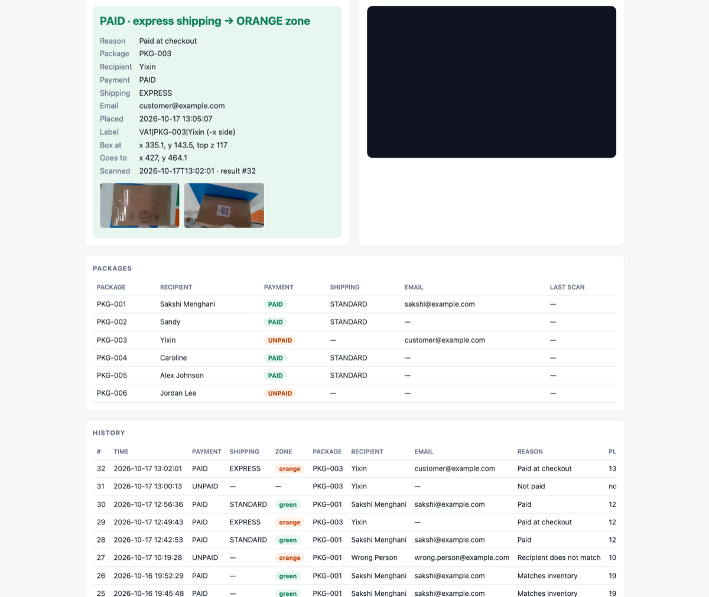
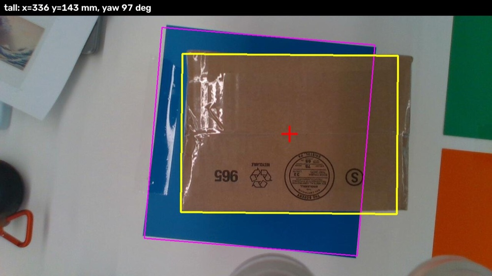
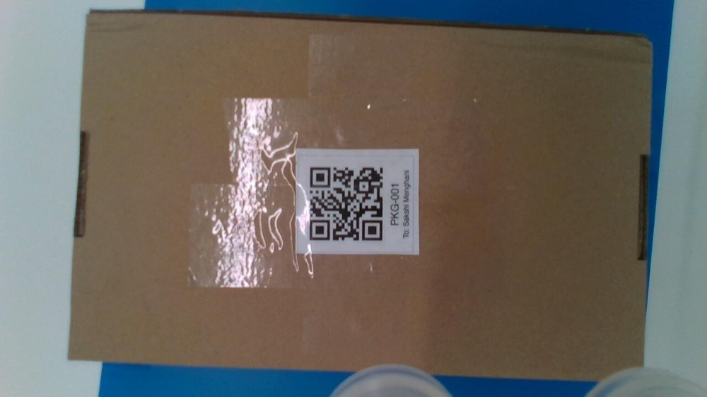
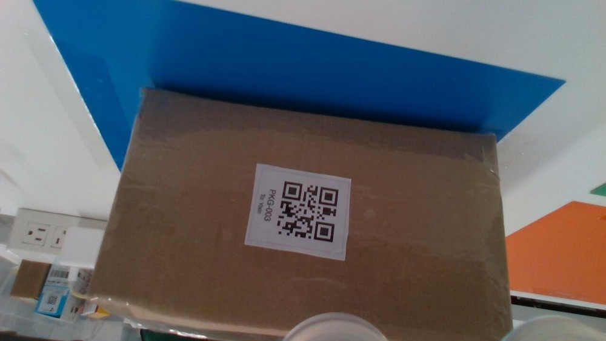
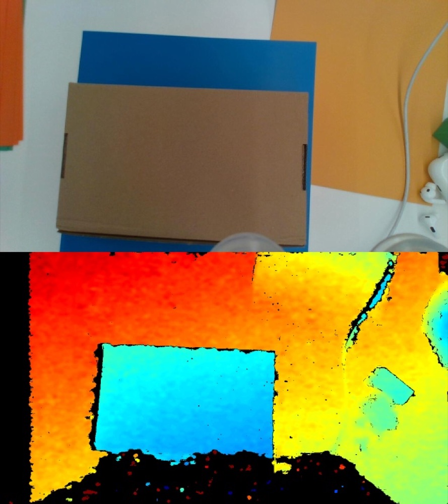
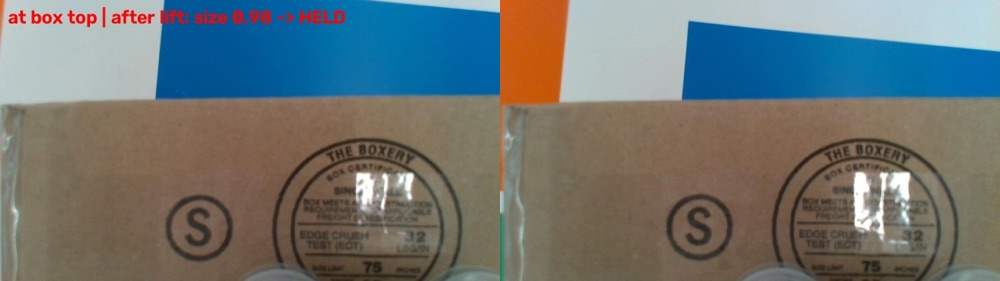
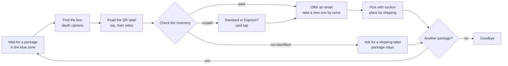

# VeriArm

**A voice checkout counter run by a robot arm.** Put a package down and VeriArm finds it, reads its QR label, checks it
against the inventory, talks you through payment and shipping, emails you a notification, and then places the
package in the right shipping area.

Built in two days at the Viam Robot Hackathon *"Code That Moves"* (Oct 16–17, 2026) on a uFactory arm with a vacuum
gripper and a wrist-mounted color + depth camera.



---

## What a checkout looks like

The table has three zones: **blue** is the counter where a package is placed, **green** is the Standard shipping
area and **orange** is the Express shipping area. This is a real conversation from the demo with an unpaid package:

> **VeriArm:** Waiting for a package in the blue zone.<br>
> *(a box is placed)*<br>
> **VeriArm:** Package detected: the tall box. Checking the label.<br>
> **VeriArm:** Label read: package P K G 0 0 3, for Yixin.<br>
> **VeriArm:** This package hasn't been paid yet. Which shipping would you like? Standard for 5 dollars, or Express for 12 dollars.<br>
> **Customer:** It's for $12.<br>
> **VeriArm:** Express shipping, 1 to 2 days, 12 dollars. Please tap your card on the purple area, then say done.<br>
> **Customer:** Done.<br>
> **VeriArm:** Payment accepted. Would you like the notification sent to your email?<br>
> **Customer:** Yes.<br>
> **VeriArm:** I don't have an email address for this package. Would you like to share one?<br>
> **Customer:** Yes. *(says the address)*<br>
> **VeriArm:** I heard … Is that right? → Sending it to … *(a real email goes out)*<br>
> **VeriArm:** Moving the package to the Express shipping area. *(picks the box and places it in orange)*<br>
> **VeriArm:** Do you have another package to send?<br>
> **Customer:** No.<br>
> **VeriArm:** Thank you, goodbye!

What VeriArm does depends on the package:

| Package | What happens |
|---|---|
| **Paid** (in the inventory with Standard or Express shipping) | "This package is paid, with Standard shipping." → email offer → placed in that shipping area |
| **Unpaid** (in the inventory, not paid yet) | Asks for Standard or Express, takes a simulated card tap, records the package as paid → email offer → placed |
| **Not identified** (no label, unknown package, or the name on the label doesn't match) | "I can't identify this package. Please generate a shipping label first." The package stays at the counter. |

## Demo images

All photos are taken by the camera on the arm's wrist during real runs.

| | |
|---|---|
|  |  |
| **1. Find the box.** From a fixed pose above the counter, the depth camera finds a box-shaped object in the blue zone (pink), matches it to a known box size (yellow) and returns its center and rotation (red cross). | **2. Read the label (top).** The arm moves the camera straight over the box and decodes the QR code: `VA1\|PKG-001\|Sakshi Menghani`. |
|  |  |
| **3. Read the label (side).** If the label isn't on top, the camera visits each side of the box at an angle until it finds one. | **4. Depth.** The box is found by height above the table in the depth image, so table colors, shadows and printing on the box don't confuse it. |
|  | |
| **5. Grip check.** The wrist camera compares the box top before and after lifting. If the printing on the box stays the same size (score 0.98), the box came up with the suction cup. The check is logged for debugging. | |

## How it works



| Part | How |
|---|---|
| **Robot** | [Viam](https://www.viam.com/) Python SDK: arm, vacuum gripper, wrist RGB-D camera and the built-in motion planner, with the table, walls and ceiling as obstacles. |
| **Vision** | OpenCV on the camera's color + depth frames: the blue zone is found by color, the box by height above the table, the label with OpenCV's QR detector. |
| **Voice** | ElevenLabs text-to-speech for VeriArm's voice and speech-to-text for the customer's answers, through the laptop's speaker and microphone. |
| **Understanding** | Claude maps free-form answers ("the fast one", "it's for $12") to a choice, and reads spoken email addresses ("sakshi dot m at gmail dot com"). With no network it falls back to keyword matching. |
| **Inventory** | SQLite, seeded from [`inventory_seed.csv`](inventory_seed.csv): package id, recipient, payment (PAID / UNPAID), shipping (STANDARD / EXPRESS) and email. Every scan and result is logged. |
| **Notifications** | A plain email over SMTP with the package, recipient, payment and shipping. |
| **Control panel** | A small web app (`ui.py`) to start and stop runs, follow each step live, see the latest result with its photos, browse the inventory and history, and reset the demo. |

## Getting started

You need Python 3.10+ (we used 3.12), a Viam machine with an arm, a vacuum gripper and a color + depth camera, and API
keys for Anthropic and ElevenLabs.

```bash
uv venv --python 3.12 .venv
source .venv/bin/activate
uv pip install -r requirements.txt
```

Create a `.env` file (it's git-ignored):

```bash
# Viam machine: from the Viam app's CONNECT tab
VIAM_ADDRESS=<machine>.viam.cloud
VIAM_API_KEY=...
VIAM_API_KEY_ID=...

# Voice and understanding
ELEVENLABS_API_KEY=...
ANTHROPIC_API_KEY=...

# Email notifications (for Gmail, use an App Password)
SMTP_USER=sender@example.com
SMTP_PASSWORD=...
```

Optional: `SMTP_HOST` / `SMTP_PORT` (default `smtp.gmail.com:587`), `SMTP_FROM` and `ELEVENLABS_VOICE_ID`.
Each package's notification address comes from the inventory; for a package without one, VeriArm asks for it by voice.

## Running it

```bash
python ui.py                                    # control panel at http://localhost:8080
python main.py                                  # voice checkout, package after package
python main.py --once                           # one package
python checkout.py --simulate PKG-003 --type    # the conversation without the robot, typing your answers
```

Before a demo, press **Reset demo** in the control panel (or run `python inventory.py reset`). It puts payment,
shipping and status back to `inventory_seed.csv` so unpaid packages go through payment again. Emails and history are
kept.

Other useful commands:

```bash
python inventory.py list                        # packages with payment, shipping and email
python inventory.py pay PKG-002 express         # mark a package paid
python inventory.py email PKG-002 you@example.com
python notify.py you@example.com                # send a test email
python make_labels.py                           # printable QR labels → labels/labels.pdf
```

**Safety:** keep someone at the arm's e-stop whenever it runs. The Stop button in the control panel halts the arm but
leaves the suction on, so a carried box isn't dropped.

## Project layout

| File | What it does |
|---|---|
| `main.py` | Entry point: connects to the robot and runs the voice checkout |
| `checkout.py` | The conversation: wait for a package, payment, shipping, email, move, another package |
| `scan.py` | Find the box, read its label, check the inventory |
| `detect.py`, `find_pick.py` | Box detection from depth; pick with suction |
| `inspection.py` | Visit the box's faces with the camera and decode the QR label |
| `place.py`, `zones.py` | Carry the box to the green or orange zone and set it down |
| `inventory.py` | SQLite inventory, `verify()`, payment, shipping, emails and results |
| `announce.py`, `voice_input.py`, `understand.py` | Speaking, listening and understanding answers |
| `notify.py` | Email notifications |
| `ui.py`, `ui.html` | Control panel |
| `label_api.py`, `make_labels.py` | QR label generation and the labels page |

The full script reference, the box finder's details and the Viam machine resources are in
[docs/REFERENCE.md](docs/REFERENCE.md).
